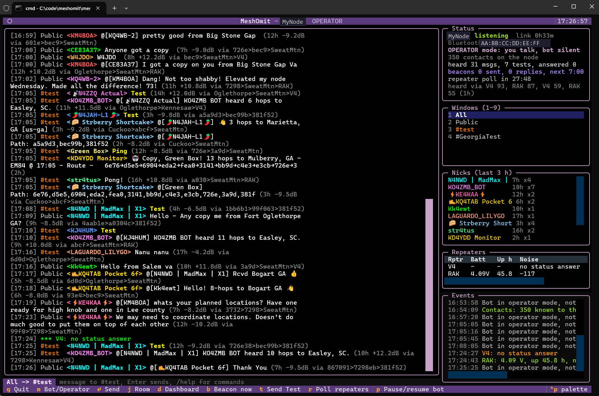
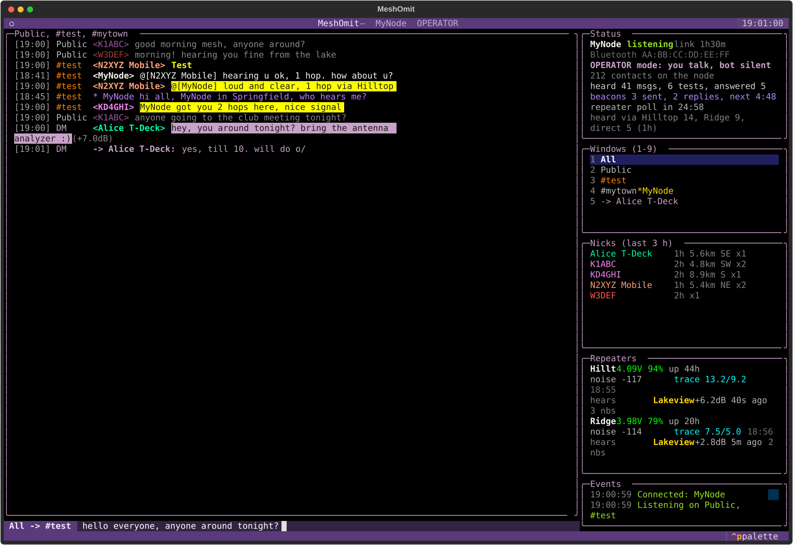
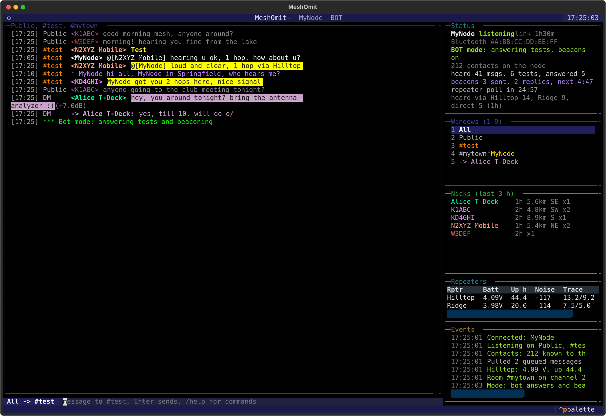
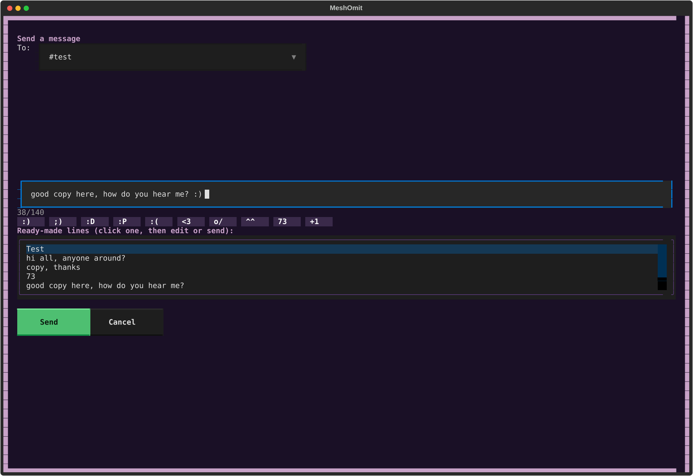
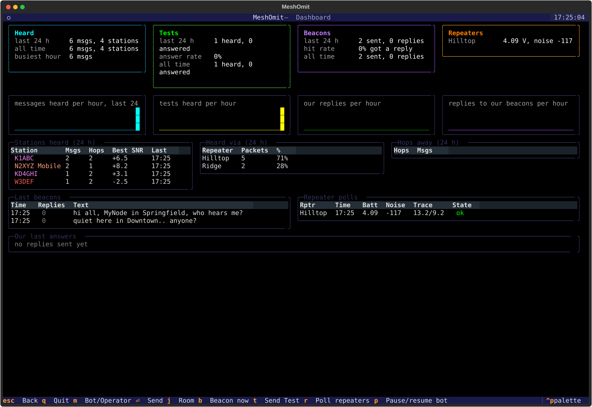

# MeshOmit



**Beta.** MeshOmit runs every day on the author's node, but it is young software: expect rough edges,
and please open an issue for anything that breaks or looks wrong. Settings and files may still change
between versions.

An IRC-style terminal client and test-reply bot for a [MeshCore](https://github.com/ripplebiz/MeshCore)
companion node, in Python. Connect a Cardputer, T-Deck, Heltec, RAK or any other board running the
companion firmware over Bluetooth, USB serial or WiFi, and MeshOmit gives you:

- **a chat screen like a classic IRC client**: one window per channel, room and private conversation,
  a nick list, `<name>` lines in one colour per station, an input line with a target label, slash
  commands, unread counters, clickable names;
- **two modes**: *Operator* (you chat, the bot is silent) and *Bot* (it answers "test", "ping" and
  "radio check" the way a person would, sends a beacon every few minutes and counts the replies);
- **rooms and invites**: create a hashtag room or a private room with a random key and invite people by
  encrypted direct message; invitations you receive are joined with one key press;
- **repeater logging**: logs in to your repeaters, records battery, uptime, noise floor, counters, trace SNR
  and the neighbour list every half hour;
- **a dashboard** of the last 24 hours and all time: messages and tests per hour, answer rate, beacon hit
  rate, stations heard, which repeater carries the traffic, hops histogram;
- **everything stored in SQLite**, safe to query while the program runs;
- **a single-file Windows executable** for people who do not want to install Python.

Everything the bot says comes from `messages.json`; every rule is in `config.json`. Nothing is hard-coded.

## Install

### Windows, without Python

1. Download `MeshOmit-1.0.0-windows.zip` from the
   [releases page](https://github.com/opensourcera/MeshOmit/releases/latest).
2. Unzip it into a folder of your choice, for example `C:\MeshOmit`. Keep the files together:
   `MeshOmit.exe`, `messages.json`, `config.example.json`.
3. Double-click `MeshOmit.exe`. Windows SmartScreen may say "Windows protected your PC" because the
   file is not signed: click *More info*, then *Run anyway*. Some antivirus programs are wary of
   PyInstaller executables; the zip's SHA-256 is on the release page if you want to check it.
4. The program opens in Windows Terminal (Windows 11) with the setup form:
   - *Bluetooth LE*: press *Scan for devices* and pick your node. The node must be on and must not be
     connected to a phone, or it stays invisible;
   - or *USB serial* and the port, or *WiFi / TCP* and the node's address;
   - a few place names, separated by commas, that the bot may say it is in;
   - *Save and start*. This writes `config.json` next to the exe.
5. A Bluetooth node that is not paired yet asks for the six-digit PIN shown on its screen.

On Windows 10 the default console is the old one, which shows no colours: install Windows Terminal from
the Microsoft Store and open `MeshOmit.exe` from it, or set it as the default terminal.

To update, replace `MeshOmit.exe`; `config.json` and the database stay.

### Linux, macOS, or Windows with Python

Python 3.11 or newer.

```
git clone https://github.com/opensourcera/MeshOmit.git
cd MeshOmit
pip install -r requirements.txt
./meshomit.sh         Linux, macOS
meshomit.cmd          Windows
```

On Linux, Bluetooth needs BlueZ and your user in the `bluetooth` group; serial needs the `dialout`
group. Pair the node once in the system's Bluetooth settings (or answer the PIN dialog the system opens).
The first start opens the same setup form.

### First minutes

The program starts in Operator mode: it listens and shows everything, and says nothing by itself. Type in
the line under the feed and press Enter to talk on the channel you are looking at. Type `/bot` or press
`m` to let the bot answer tests and send beacons; `/help` lists the commands. The
[user guide](docs/user-guide.md) explains the screen.

## Documentation

| document | content |
|---|---|
| [docs/user-guide.md](docs/user-guide.md) | the screen, windows, input line, commands, keys, modes, rooms, private messages, whois, dashboard |
| [docs/configuration.md](docs/configuration.md) | every key of `config.json` and every list of `messages.json`, the human pass |
| [docs/architecture.md](docs/architecture.md) | how the program is built: modules, engine and screen, asyncio tasks, connection layer, database schema |
| [docs/building.md](docs/building.md) | running from source, building `MeshOmit.exe`, running the tests |
| [docs/troubleshooting.md](docs/troubleshooting.md) | grey colours, a phone holding the node, PIN, missing contacts, no messages |
| [CHANGELOG.md](CHANGELOG.md) | what changed |
| [CREDITS.md](CREDITS.md) | the projects and people MeshOmit builds on |

## A look at the screen

Operator mode, in lilac: the feed with one colour per station, a test call in yellow, a mention and a
direct message highlighted, the window list with a room and a private conversation, the nick list with
hops and distances, the repeater table and the input line with its target label.



Bot mode turns the screen blue, so the mode is visible from across the room:



The big send window (Enter on an empty line) with the character counter, the emoticon buttons and the
ready-made lines, and the dashboard (`d`):





The picture at the top of this page is a live session on a busy regional mesh (the node's name and
address are replaced). The four renders above are made by `tools/screenshot.py` from a fake node, and
every name, call sign and place in them is made up.

## The screen, panel by panel

| panel | what it shows |
|---|---|
| **Title bar** | your node's name and the mode, OPERATOR or BOT, with the clock |
| **Feed** (left, large) | one line per message: time, channel, `<sender>`, text, then hops, SNR and the last repeaters it came through, like "(3h +5.5dB via Hilltop>Ridge)". Its title is the window you are looking at |
| **Input line** (under the feed) | where you type. The label in front names where Enter sends: a channel, a room, or `<name>` for a private message. Slash commands start with `/`, `/help` lists them. `/reply` (or the `a` key) prepares an answer to the last test call with the station's name, hops, repeaters, SNR and your place, for you to check and send. Typing `{` opens a list of fields (`{hops}`, `{via}`, `{snr}`, `{location}`, `{time}`...) that are filled in when you send, and the emoticons shown as pictures, inserted as text |
| **Status** (top right) | link state and uptime, mode, number of contacts on the node, messages and tests heard, answers given, beacons sent and replied to, time to the next beacon and the next repeater poll, which repeaters carried the traffic in the last hour |
| **Windows (1-9)** | one entry per channel, room and private conversation, with unread counts; the number in front selects it. A room shows its creator after `*` |
| **Nicks (last 3 h)** | who spoke in the selected window, most recent first, with hops ("direct", "2h"), distance and direction when both nodes advertise a position, and how many messages |
| **Repeaters** | the last poll of each configured repeater: battery, uptime in hours, noise floor, trace SNR there/back |
| **Events** | what the program did and why: connection steps, contacts loaded, beacons, why the bot stayed quiet, invitations, repeater results |
| **Footer** | the single-key shortcuts (they work when the input line is not focused; press Escape) |

Everything is clickable: windows, nicks, names in the feed, buttons and lists in the dialogs.

## What the colours mean

| colour | meaning |
|---|---|
| **lilac frame and title bar** | Operator mode: you chat, the bot is silent |
| **blue frame and title bar** | Bot mode: the bot answers tests and sends beacons |
| **one colour per `<name>`** | each station keeps its colour everywhere (feed, nick list, dashboard), derived from its name |
| white text | a message received on a channel |
| dimmed grey text | a message that was queued on the node before the program started; never answered |
| **yellow text** | a test call ("Test", "ping", "radio check") the bot answers in Bot mode |
| black on yellow | someone named your node with `@[YourNode]`, or replied to your beacon |
| purple `* YourNode ...` | a beacon your bot sent |
| bright white `<YourNode>` | your own messages and the bot's answers |
| black on lilac | a direct message received: encrypted, only you can read it |
| lilac `-> name:` | a direct message you sent |
| green `***` | lines from the program itself (keys, room created, who invited you) |
| grey `(3h +5.5dB via ...)` | hops, SNR and repeaters of the strongest copy heard |
| gold `*name` | the creator of a room, in the window list and at the head of its nick list |
| orange / green / yellow in the Events panel | problems / things that worked / plain progress |

## What the bot does

In Bot mode (`m` or `/bot`) the program behaves like a patient person sitting at the node:

1. It listens on every channel the node has (Public, #test, your rooms) and shows and stores everything.
2. When a message on a reply channel (by default only #test, so Public stays clean) is exactly a test word
   ("test", "ping", "radio check", the list is yours), it is a test call.
3. It stays quiet if the sender's name contains "bot", if it answered that station less than 10 minutes
   ago, if it already gave 6 answers in the last hour, or if the message was queued on the node before
   the program started. The Events panel says which rule applied.
4. Otherwise it waits a random 2 to 6 seconds, so it does not collide with other bots and does not look
   like a machine.
5. It picks a line from `messages.json` that this station has not received yet, in random order, and
   starts again only when the station has had them all. Lines quoting the SNR are skipped when the SNR is
   unknown. Now and then (15 %) it just says "brb" instead.
6. It fills the blanks: the station's name as a mention (`@[name]`, highlighted in the MeshCore apps),
   one of your place names at random, the hop count, the SNR.
7. The line goes through the human pass: "you" becomes "u", "thanks" becomes "thx", one word may get a
   slip of the finger, the final full stop goes. Both chances are yours to set, 0 for clean text.
8. It sends the answer on the channel the test came from and stores it with a link to the test.
9. Every 10 minutes it sends a beacon from your list ("hi all, MyNode in Springfield, who hears me?"),
   never the same line twice in a row, and counts every message that names it in the next 10 minutes as a
   reply to that beacon. The dashboard shows the hit rate.
10. Optionally (`answer_mentions`) it also answers people who name it without a test word, from a
    separate list of lines.
11. Every 30 minutes it logs in to your repeaters, records battery, uptime, noise floor, counters, a
    trace SNR and the neighbour list. This runs in Operator mode too.

In Operator mode it does 1 and 11 only, and you do the talking. `p` pauses the answers without leaving
Bot mode. Everything the bot says is in `messages.json`; every limit is in `config.json`
(see [docs/configuration.md](docs/configuration.md)).

## Files

```
meshomit/            the program: app.py (screen), core.py (engine), connection.py, ble.py, pairing.py, db.py
messages.json        what the bot says, the quick lines and the emoticons
config.example.json  every setting with its default; the setup form writes config.json for you
meshomit.cmd, meshomit.sh   launchers
build_exe.cmd, meshomit_exe.py   the Windows single-file build
tests/               headless tests of the screen with a fake node
tools/               screenshot.py renders the pictures above from the fake node
docs/                the documentation
```

`config.json`, the SQLite database and the build output are ignored by git on purpose: they hold your
node's Bluetooth address, PIN and traffic.

## Licence

MIT, Copyright (c) 2026 opensourcera. See `LICENSE` and `CREDITS.md`.
